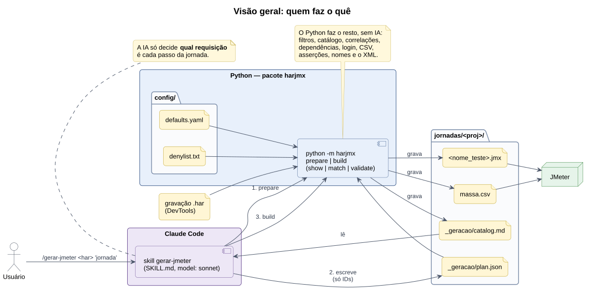
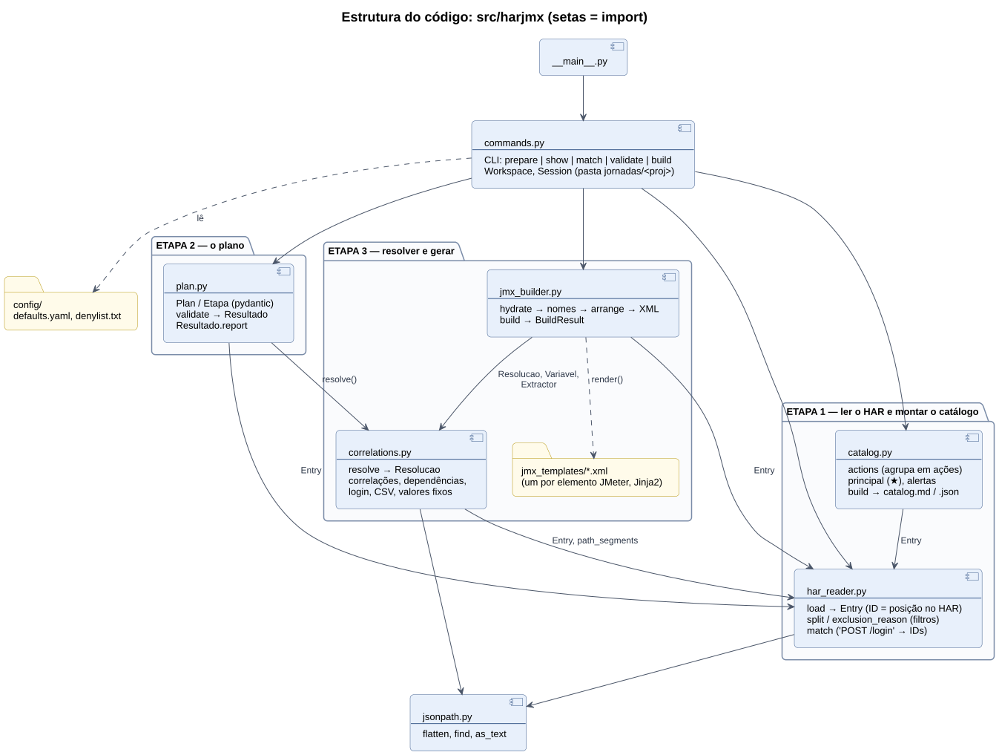
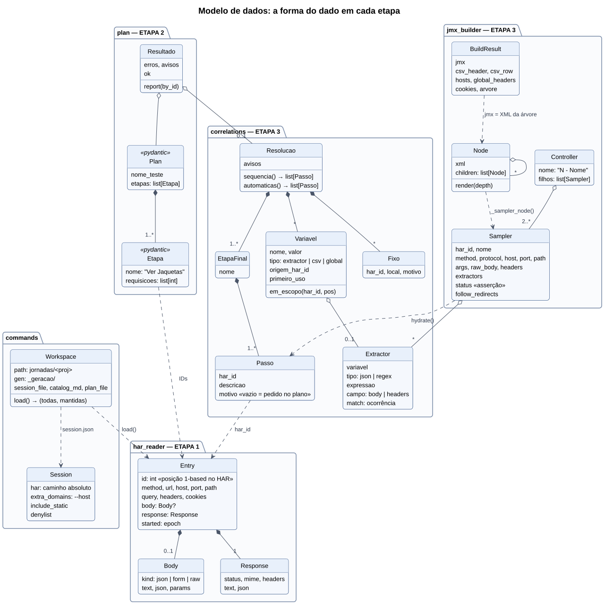
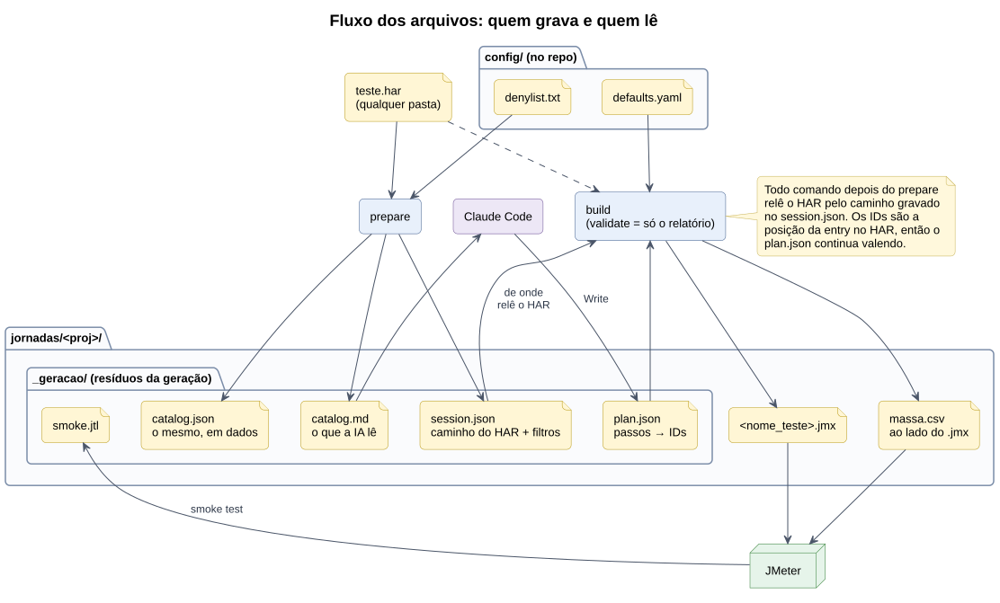
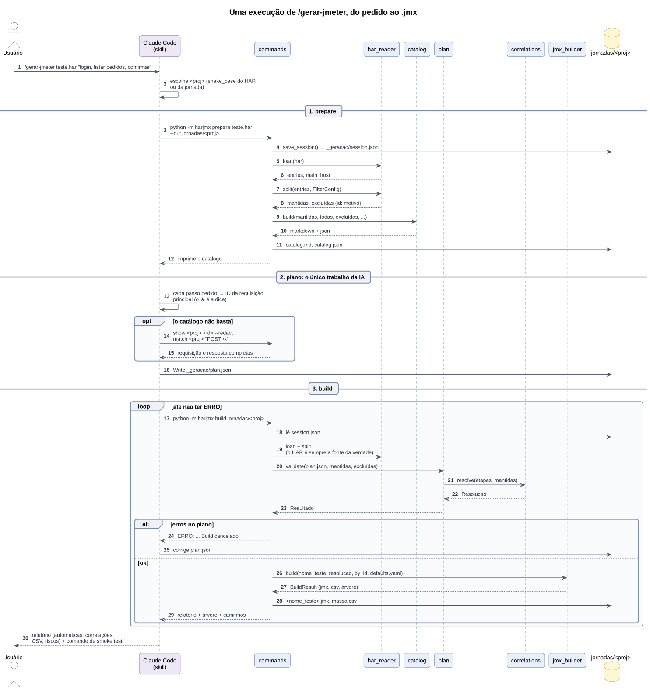
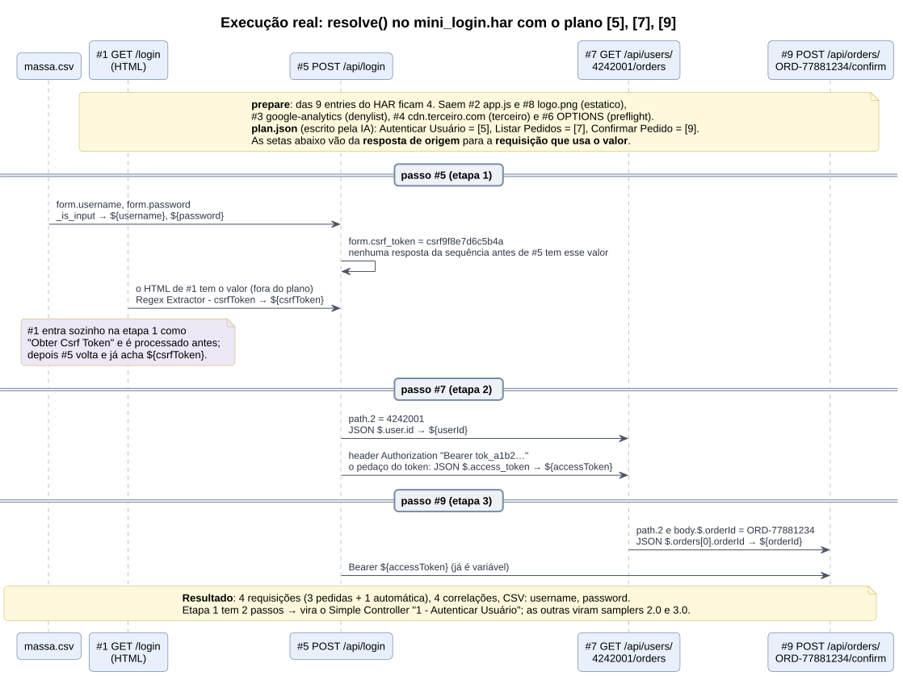
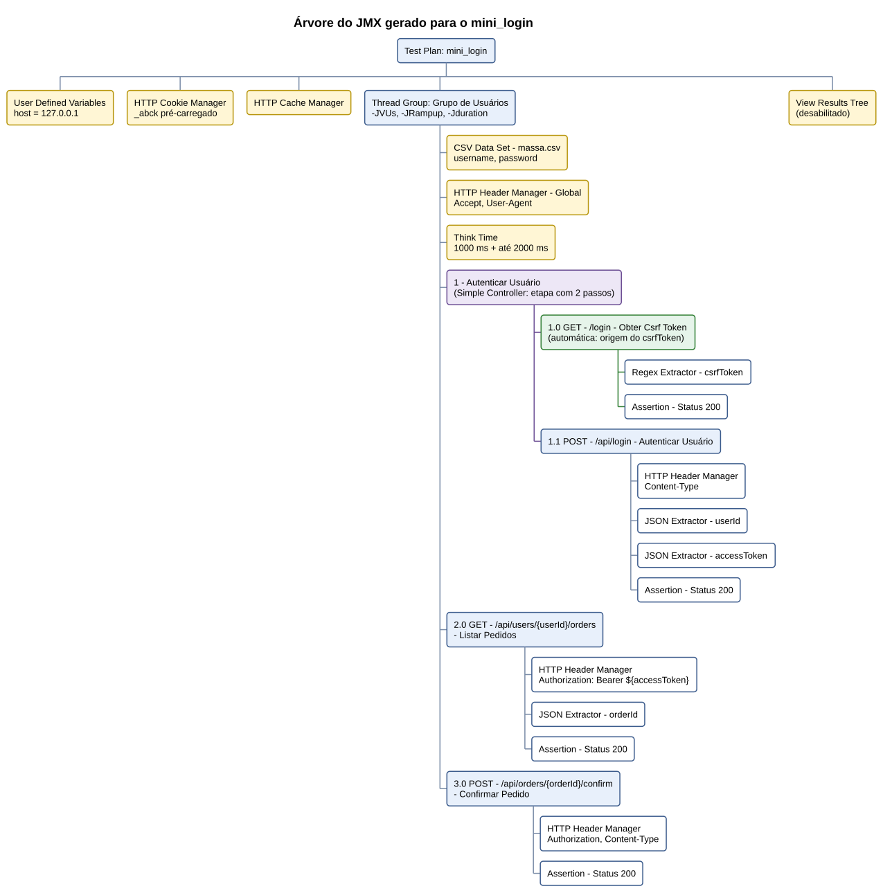
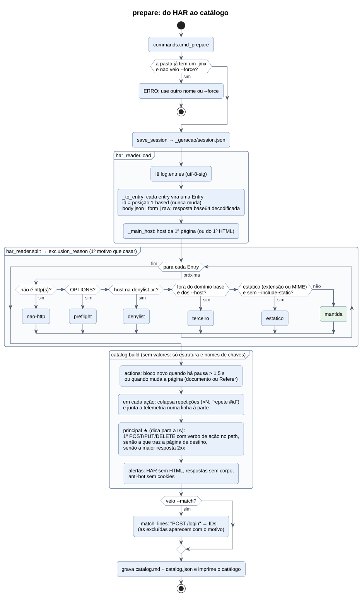
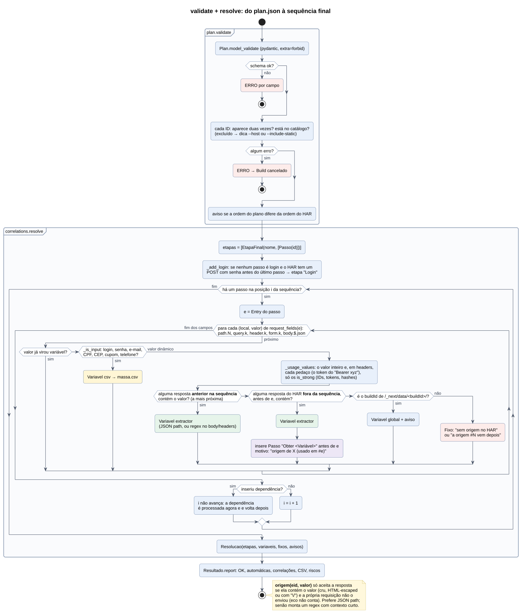
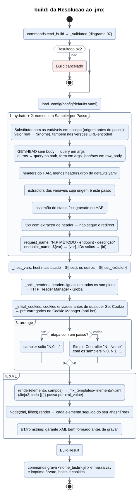

# Como o código funciona

Para quem vai manter ou mudar o Agente JMeter. Para **usar**, veja o [GUIA.md](GUIA.md).

## A ideia
A IA faz uma coisa só: diz **qual requisição do HAR é cada passo** da jornada, num `plan.json` com
IDs. Todo o resto é Python determinístico, sem IA: filtrar o HAR, montar o catálogo, achar a origem
de cada valor dinâmico, incluir dependências e login, separar a massa de CSV, nomear e gerar o XML.

Por quê:
- a IA não copia headers nem bodies, então não erra valores. Ela lê só o catálogo, que tem a
  estrutura e os nomes das chaves, nunca os valores (senhas e tokens não passam por ela);
- o mesmo HAR com o mesmo plano gera sempre o mesmo `.jmx` (é o que o teste golden confere);
- a skill fica curta e rápida: 3 chamadas (`prepare`, escrever o plano, `build`).

## 1. Visão geral


A skill [`gerar-jmeter`](../.claude/skills/gerar-jmeter/SKILL.md) orienta o Claude Code. O pacote
`harjmx` (`python -m harjmx`) faz o trabalho. Tudo que é gerado fica em `jornadas/<proj>/`, na pasta
onde o Claude foi aberto.

## 2. Estrutura do código


| Arquivo | Etapa | O que faz | Funções principais |
|---|---|---|---|
| [har_reader.py](../src/harjmx/har_reader.py) | 1 | Lê o HAR, decide o que fica no catálogo e casa endpoints com IDs | `load`, `split`, `exclusion_reason`, `match`, `field_value` |
| [catalog.py](../src/harjmx/catalog.py) | 1 | Agrupa as requisições em ações do usuário e escreve o catálogo para a IA | `build`, `actions`, `principal`, `alertas`, `shape` |
| [plan.py](../src/harjmx/plan.py) | 2 | Contrato do `plan.json`, validação contra o HAR e relatório | `Plan`, `Etapa`, `validate`, `Resultado.report` |
| [correlations.py](../src/harjmx/correlations.py) | 3 | Monta a sequência final: correlações, dependências, login, CSV, valores fixos | `resolve`, `request_fields`, `is_strong`, `build_regex`, `is_login` |
| [jmx_builder.py](../src/harjmx/jmx_builder.py) | 3 | Transforma a sequência no XML do JMeter | `build`, `hydrate`, `Substituter`, `arrange`, `render`, `Node` |
| [jmx_templates/](../src/harjmx/jmx_templates/) | 3 | Um `.xml` (Jinja2) por elemento JMeter | — |
| [commands.py](../src/harjmx/commands.py) | — | Linha de comando e pasta do script | `main`, `cmd_prepare`, `cmd_build`, `Workspace` |
| [jsonpath.py](../src/harjmx/jsonpath.py) | — | O subconjunto de JSONPath que o JMeter entende | `flatten`, `find`, `as_text` |

Duas regras seguram o desenho:
- **Só o `har_reader` conhece o JSON cru do HAR.** O resto do pacote trabalha com `Entry`.
- **O ID de uma requisição é a posição dela no HAR** (1, 2, 3...). Ele não muda entre execuções,
  então o `plan.json` continua válido quando qualquer comando relê o HAR.

## 3. Modelo de dados


O dado muda de forma em cada etapa:

```
Entry (HAR)  →  Etapa.requisicoes (IDs da IA)  →  Passo (+ automáticos)  →  Sampler  →  Node  →  XML
```

- `Entry`: uma requisição do HAR, já com body e resposta decodificados.
- `Plan` / `Etapa`: o que a IA escreveu (pydantic, `extra="forbid"`: campo a mais é erro).
- `Resolucao`: as etapas finais com os `Passo`s (pedidos e automáticos; `motivo` vazio = pedido),
  as `Variavel`s (`extractor`, `csv` ou `global`) e os `Fixo`s (valores que ficaram literais).
- `Sampler`: o passo hidratado, com `${variavel}` no lugar dos valores reais.
- `Node`: um elemento XML e seus filhos. Cada um vira o elemento seguido do seu `<hashTree>`.

## 4. Fluxo dos arquivos


| Arquivo | Quem grava | Quem lê | Para quê |
|---|---|---|---|
| `teste.har` | DevTools | `prepare`, `build` | Fonte da verdade: valores, respostas, ordem |
| `_geracao/session.json` | `prepare` | todos os outros comandos | Caminho do HAR e filtros (`--host`, `--include-static`, denylist) |
| `_geracao/catalog.md` | `prepare` | Claude | Catálogo por ações, sem valores |
| `_geracao/catalog.json` | `prepare` | — | O mesmo catálogo em dados, para depuração |
| `_geracao/plan.json` | Claude (Write) | `validate`, `build` | Passos → IDs |
| `<nome_teste>.jmx` | `build` | JMeter | O script |
| `massa.csv` | `build` | JMeter (CSV Data Set) | Login, senha, CEP, cupom... Precisa ficar ao lado do `.jmx` |
| `_geracao/smoke.jtl` | JMeter | quem roda o smoke test | Resultado do teste rápido |

## 5. Uma execução real, passo a passo


O exemplo usa o HAR sintético dos testes, [tests/fixtures/mini_login.har](../tests/fixtures/mini_login.har):
uma tela de login (com CSRF no HTML), o POST de login, a lista de pedidos do usuário e a
confirmação de um pedido, mais ruído (JS, imagem, Google Analytics, CDN de terceiro, preflight).
Para reproduzir:

```powershell
python -m harjmx prepare tests/fixtures/mini_login.har --out jornadas/mini_login
Copy-Item tests/fixtures/mini_login.plan.json jornadas/mini_login/_geracao/plan.json
python -m harjmx build jornadas/mini_login
```

### 5.1 `prepare`: o catálogo
Das 9 requisições ficam 4. A saída real:

```
Host principal: 127.0.0.1. Mantidas 4 de 9 (excluídas: estatico 2, denylist 1, terceiro 1, preflight 1).
Terceiros excluídos (se for da aplicação, rode o prepare com `--host <dominio>`): cdn.terceiro.com (1)

### A1 +0.0s — página /login
★ #1 GET 200 /login → text/html (137 chars)

### A2 +0.0s — página ?
★ #5 POST 200 /api/login → json{access_token, user{id, name}} | req: form{csrf_token, username, password}
#7 GET 200 /api/users/4242001/orders?page → json{orders[1]{orderId, total}}
#9 POST 200 /api/orders/ORD-77881234/confirm → json{status} | req: json{orderId, note}

Fim do catálogo: 2 ações, 4 requisições.
```

Repare que o catálogo mostra `form{csrf_token, username, password}`, mas não os valores.

### 5.2 O plano (o único trabalho da IA)
Para a jornada "autenticar, listar pedidos, confirmar pedido", a IA escolhe uma requisição por passo:

```json
{"nome_teste": "mini_login",
 "etapas": [{"nome": "Autenticar Usuário", "requisicoes": [5]},
            {"nome": "Listar Pedidos", "requisicoes": [7]},
            {"nome": "Confirmar Pedido", "requisicoes": [9]}]}
```

### 5.3 `build`: como o Python completa o plano


O relatório real do `build`:

```
OK: 4 requisições (3 pedidas + 1 automáticas), 4 correlações, CSV: username, password
Automáticas:
  #1 GET /login — origem de csrfToken (usado em #5)
Correlações:
  csrfToken ← #1 regex `name="csrf_token" value="([^"\r\n]+)`
  userId ← #5 json `$.user.id`
  accessToken ← #5 json `$.access_token`
  orderId ← #7 json `$.orders[0].orderId`
Árvore:
  1 - Autenticar Usuário
    1.0 GET - /login - Obter Csrf Token
    1.1 POST - /api/login - Autenticar Usuário
  2.0 GET - /api/users/{userId}/orders - Listar Pedidos
  3.0 POST - /api/orders/{orderId}/confirm - Confirmar Pedido
Hosts: ${host}=127.0.0.1
Cookies pré-carregados: _abck
```

A IA não pediu o `GET /login`: o Python incluiu sozinho porque o `csrf_token` do login só existe no
HTML dele. O `massa.csv` sai com `username,password` e os valores reais do HAR.

### 5.4 O JMX gerado


É exatamente o [golden do teste](../tests/golden/mini_login.jmx). O teste e2e roda esse `.jmx` no
JMeter contra o [mock](../tests/mock_server.py), que gera CSRF, token e IDs novos a cada chamada:
ele só passa se as correlações estiverem certas.

## 6. Por dentro de cada etapa

### 6.1 `prepare`


- **Filtros** (`exclusion_reason`): vale o primeiro motivo que casar, nesta ordem: `nao-http`,
  `preflight` (OPTIONS), `denylist` ([config/denylist.txt](../config/denylist.txt)), `terceiro` (fora do
  domínio base do host principal e dos `--host`) e `estatico` (extensão ou MIME).
- **Ações** (`actions`): um bloco novo começa numa pausa de mais de 1,5 s (`PAUSA_ACAO`) ou quando
  muda a página. A página vem do próprio path, se for navegação, ou do `Referer`.
- **★** (`principal`): só uma dica. É o primeiro POST/PUT/DELETE com verbo de ação no path
  (`add`, `claim`, `login`...); senão, a requisição que traz a página de destino; senão, a maior
  resposta 2xx.
- **Alertas**: HAR sem HTML (gravado com filtro Fetch/XHR), respostas sem corpo e anti-bot sem cookies.

### 6.2 `validate` e `resolve`


`plan.validate` checa o schema e os IDs. Os erros dizem como corrigir (ex.: "excluída como
'terceiro' (rode o prepare com --host...)"), para o agente ajustar o plano sozinho. Se o plano está
ok, `correlations.resolve` monta a sequência final:

- **Login**: se nenhum passo pedido é login e o HAR tem um POST com senha antes do último passo, ele
  entra como etapa "Login".
- **Massa de CSV**: campos que o usuário digita (`_INPUT_KEY`: login, e-mail, senha, CPF, CEP,
  cupom, telefone...) viram colunas do `massa.csv`.
- **Correlação**: para cada valor dinâmico enviado (`is_strong`: tem dígitos, não é data nem versão,
  ou é longo e não parece palavra), a origem é a **resposta mais próxima antes** do uso. Procura
  primeiro dentro da sequência. Se não achar, procura no HAR, fora da sequência.
- **Dependência**: se a origem está fora da sequência, aquela requisição entra como passo "Obter
  <Variável>" logo antes de quem usa o valor. Ela é processada na hora, porque também pode
  depender de outras.
- **Extractor**: JSON path quando a resposta é JSON; senão, um regex com o menor contexto à esquerda
  que acerta o valor (`build_regex`), no body ou nos headers.
- **Valor fixo**: sem origem no HAR, ou com origem só depois do uso. Fica literal e aparece nos
  riscos do relatório. O `buildId` do Next.js é a exceção: vira variável global, com aviso.

### 6.3 `build`


1. **Hidratação** (`hydrate`): cada passo vira um `Sampler` com os dados reais do HAR. O
   `Substituter` troca os valores por `${variavel}`, mas só as variáveis cuja origem vem antes do
   passo. Cada sampler ganha a asserção do status 2xx gravado.
2. **Nomes**: `1.0 POST - /api/login - Autenticar Usuário`. No endpoint, `${var}` vira `{var}` e IDs
   soltos viram `{id}` (as regras estão em [boas-praticas.md](../.claude/skills/gerar-jmeter/boas-praticas.md)).
3. **Estrutura** (`arrange`): uma etapa com um só passo vira um sampler solto (`N.0`). Uma etapa com
   vários passos vira um Simple Controller `N - Nome`.
4. **XML**: cada elemento sai do seu template em `jmx_templates/`. Os headers iguais em todos os
   samplers vão para o Header Manager global. Os cookies que o navegador já tinha antes de qualquer
   `Set-Cookie` são pré-carregados no Cookie Manager. Antes de gravar, `ET.fromstring` confere que o
   XML está bem formado.

## 7. Onde mexer

| Quero... | Mexa em | Depois |
|---|---|---|
| Mudar o XML de um elemento (propriedades, valores padrão) | `src/harjmx/jmx_templates/<elemento>.xml` | `UPDATE_GOLDEN=1 python -m pytest` |
| Mudar o thread group, o think time, os headers descartados ou os listeners | [config/defaults.yaml](../config/defaults.yaml) | idem |
| Descartar um domínio de telemetria | [config/denylist.txt](../config/denylist.txt) | — |
| Reconhecer um novo campo digitado (vira CSV) | `_INPUT_KEY` em `correlations.py` | teste em `tests/test_correlations.py` |
| Ignorar um header que muda sozinho (APM, trace) | `_IGNORED_REQUEST_HEADERS` em `correlations.py` | idem |
| Melhorar a dica ★ ou a detecção de telemetria | `_ACTION_VERB`, `_TELEMETRY` e `principal` em `catalog.py` | `tests/test_catalog.py` |
| Mudar a nomenclatura | `request_name`, `endpoint_name` e afins em `jmx_builder.py` | golden |
| Mudar o que a IA faz ou como ela reporta | [SKILL.md](../.claude/skills/gerar-jmeter/SKILL.md) | — |

Testes:
```powershell
python -m pytest            # unitários + golden do JMX (< 1 s)
python -m pytest -m e2e     # roda o JMX no JMeter real contra o mock local (~20 s)
```

## 8. Diagramas
As fontes estão em [docs/diagramas/](diagramas/) (`.puml`, com o estilo comum em `_estilo.iuml`). Os
SVGs em `diagramas/svg/` são gerados: não edite à mão. Para regenerar depois de mudar um `.puml`
(precisa de Java e do [plantuml.jar](https://plantuml.com/download); no Windows o jar já traz o
Graphviz):

```powershell
java -jar plantuml.jar -charset UTF-8 -tsvg -o svg docs/diagramas
```

Para ver enquanto edita, use a extensão PlantUML no VS Code (`Alt+D` abre o preview).
